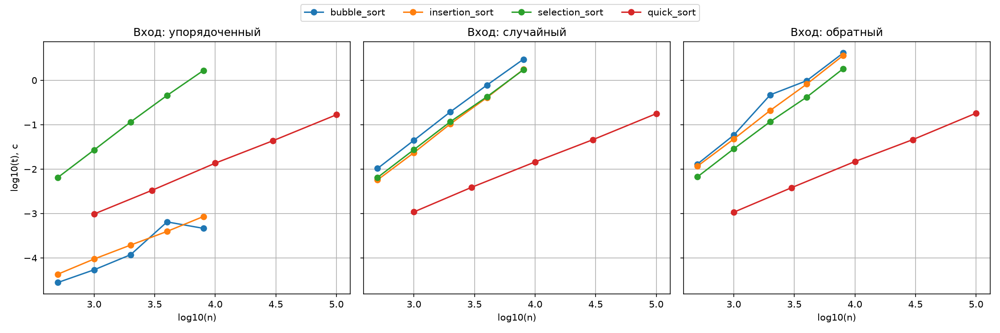

# Лабораторная работа 3. Простые сортировки и QuickSort

## Цель работы
Освоить простые сортировки и QuickSort, экспериментально подтвердить их асимптотику на разных классах входов и понять роль стабильности и рандомизации опорного элемента.

## Задание
1. Реализовать сортировки пузырьком, вставками и выбором со счётчиками сравнений и обменов.
2. Реализовать QuickSort с рандомизированным выбором опорного элемента.
3. Сгенерировать три класса входов (упорядоченный, случайный, обратный) и выполнить замеры.
4. Продемонстрировать стабильность/нестабильность алгоритмов.
5. Построить log-log графики и сопоставить наклоны с O(n²) и O(n log n).

## Реализованные алгоритмы
Код всех алгоритмов находится в файле [`lab03-simple-sorts-quicksort.py`](lab03-simple-sorts-quicksort.py).

- `bubble_sort` — сортировка пузырьком (O(n²), O(n) в лучшем).
- `insertion_sort` — сортировка вставками (O(n²), O(n) в лучшем).
- `selection_sort` — сортировка выбором (всегда O(n²)).
- `quick_sort` — быстрая сортировка с рандомизацией опорного элемента (O(n log n)).

## Результаты замеров и счётчики
На примере n=1000 (случайный вход) получены следующие счётчики:
- bubble_sort: 498 597 сравнений, 242 438 обменов.
- insertion_sort: 243 433 сравнения, 242 438 перемещений.
- selection_sort: 499 500 сравнений, 994 обмена.

Сортировка выбором всегда выполняет ровно `n(n-1)/2` сравнений, что подтверждает независимость её сложности от типа входа.

## Демонстрация стабильности
Для проверки стабильности был взят массив пар `[(2, "a"), (1, "b"), (2, "c"), (1, "d")]`. Сортировка производилась по ключу.
- bubble_sort и insertion_sort — стабильные (метки 'a' и 'c' сохранили свой исходный порядок).
- selection_sort и quick_sort — нестабильные (порядок меток может нарушаться при равных ключах).

## Графики
Ниже представлен log-log график времени работы алгоритмов на трёх классах входов.

### Анализ графиков:
1. Упорядоченный вход: линии bubble_sort и insertion_sort почти горизонтальны (наклон ~1), что подтверждает их O(n) в лучшем случае. selection_sort растёт (O(n²)), так как не зависит от входа.
2. Случайный и обратный вход: bubble_sort, insertion_sort и selection_sort показывают крутой рост (наклон ~2), что подтверждает O(n²).
3. QuickSort (красная линия): на всех типах входа показывает наклон ~1 (O(n log n)), оставаясь самым быстрым алгоритмом. На n=100 000 он работает за 0.17 секунды против 4.1 секунды у пузырька.

## Вывод
В ходе лабораторной работы были реализованы три простые сортировки и QuickSort с рандомизацией. Экспериментально подтверждено, что пузырёк и вставки имеют сложность O(n) на упорядоченных данных (за счёт досрочного выхода) и O(n²) на случайных. Сортировка выбором всегда работает за O(n²), что доказано теоретически (всегда n(n-1)/2 сравнений) и подтверждено счётчиками. QuickSort с рандомизацией опорного элемента показал наилучшую производительность O(n log n) на всех типах входов.