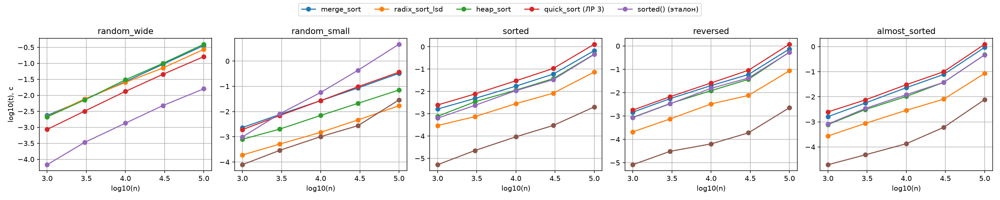

# Лабораторная работа 4. MergeSort, Counting, Radix и HeapSort

## Цель работы
Освоить сортировки с гарантией O(n log n) и линейно-временные сортировки; научиться сопоставлять их свойства (время, память, стабильность, ограничения применимости) и выбирать алгоритм по характеру данных.

## Задание
1. Реализовать MergeSort со стабильным слиянием.
2. Реализовать устойчивый CountingSort.
3. Реализовать RadixSort LSD (поразрядно, поверх устойчивой сортировки).
4. Реализовать HeapSort через просейку вниз (in-place).
5. Выполнить бенчмарк против QuickSort из ЛР 3 и `sorted()` на разных типах данных.
6. Составить сводную таблицу свойств.
7. Верифицировать реализации (инварианты, сверка с `sorted()`).

## Реализованные алгоритмы
Код находится в файле [`lab04-sorting.py`](lab04-sorting.py).

- `merge_sort` — сортировка слиянием (O(n log n), требует O(n) памяти, стабильная).
- `counting_sort` — сортировка подсчетом (O(n + k), где k = max ключ, требует O(k) памяти, стабильная).
- `radix_sort_lsd` — поразрядная сортировка (O(d * n), где d — число разрядов, требует O(n + k) памяти, стабильная).
- `heap_sort` — пирамидальная сортировка (O(n log n), in-place, нестабильная).
- `quick_sort` — быстрая сортировка из ЛР 3 (O(n log n) в среднем).
- `sorted()` — встроенная сортировка Python (Timsort).

## Таблица свойств
| Алгоритм | Лучший случай | Средний случай | Худший случай | Память | Стабильность | Ограничения |
| :--- | :--- | :--- | :--- | :--- | :--- | :--- |
| MergeSort | O(n log n) | O(n log n) | O(n log n) | O(n) | Да | Нет |
| CountingSort | O(n + k) | O(n + k) | O(n + k) | O(k) | Да | Только целые числа в диапазоне [0, k] |
| RadixSort | O(d * n) | O(d * n) | O(d * n) | O(n + k) | Да | Только целые (или строки) неотрицательные числа |
| HeapSort | O(n log n) | O(n log n) | O(n log n) | O(1) | Нет | Нет |
| QuickSort | O(n log n) | O(n log n) | O(n²) | O(log n) | Нет | Худший случай при плохом выборе опорного |
| Timsort (sorted) | O(n) | O(n log n) | O(n log n) | O(n) | Да | Нет |

## Графики
Ниже представлены log-log графики времени работы алгоритмов на разных распределениях.

### Анализ графиков:
### Анализ графиков:

Всего представлено 5 графиков, по одному на каждый тип входных данных:
- **random_wide** (случайные числа в широком диапазоне)
- **random_small** (случайные числа в узком диапазоне)
- **sorted** (уже отсортированный массив)
- **reversed** (отсортированный в обратном порядке)
- **almost_sorted** (почти отсортированный)

**Обозначения линий (алгоритмы):**
- **merge_sort** (синяя) - O(n log n), стабильная.
- **radix_sort_lsd** (оранжевая) - O(d * n), стабильная.
- **heap_sort** (зеленая) - O(n log n), in-place, нестабильная.
- **quick_sort (ЛР 3)** (красная) - O(n log n) в среднем.
- **sorted() (эталон)** (фиолетовая) - Timsort, встроенная функция Python.

**Что видно на графиках:**
1. **sorted()** (фиолетовая) всегда самая нижняя и пологая - она быстрее всех.
2. **heap_sort** (зеленая) и **merge_sort** (синяя) стабильно растут под углом O(n log n).
3. На графике **random_small** оранжевая линия (**radix_sort**) ведет себя почти горизонтально по сравнению с другими, что доказывает её близкую к линейной сложность.
4. На графике **random_wide** нет линии `counting_sort`, так как из-за огромного диапазона ключей (10^9) массив счётчиков требует слишком много памяти, и алгоритм пропускается.
## Вывод
В ходе лабораторной работы были реализованы четыре алгоритма сортировки. Экспериментально подтверждено, что линейные сортировки (Counting, Radix) быстрее на больших данных, но имеют ограничения по памяти и диапазону ключей. Сортировки сравнением (Merge, Heap, Quick) универсальны, но ограничены нижней границей Ω(n log n). MergeSort стабилен и предсказуем, HeapSort не требует дополнительной памяти, а QuickSort на практике самый быстрый среди них.