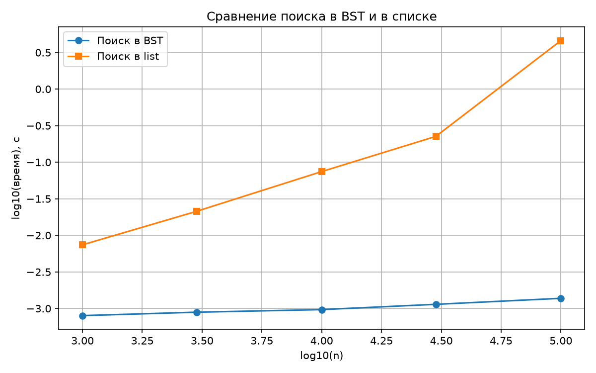

# Лабораторная работа 5. Бинарное дерево поиска (BST)

## Цель работы
Освоить структуру «бинарное дерево поиска»: реализовать вставку, поиск и удаление, четыре обхода дерева, научиться проверять инвариант BST и объяснять зависимость сложности операций от высоты дерева.

## Задание
1. Реализовать класс BST с операциями insert, search и delete (обработать все три случая удаления).
2. Реализовать обходы дерева: in-order, pre-order, post-order (рекурсивно) и level-order (итеративно через deque).
3. Реализовать вычисление высоты дерева и подсчёт числа узлов.
4. Верифицировать инвариант BST (in-order даёт возрастающую последовательность) и сверить с эталоном set на случайных данных.
5. Сравнить время поиска в BST и в списке (in) по методике бенчмаркинга.
6. В отчёте объяснить асимптотику через высоту дерева h.

## Реализованные алгоритмы
Код находится в файле [`lab05-bst.py`](lab05-bst.py).

- `insert` - вставка ключа. Спуск от корня, O(h).
- `search` - поиск ключа. Спуск от корня, O(h).
- `delete`- удаление ключа (три случая: лист, один ребёнок, два ребёнка через преемника). O(h).
- `in_order`, `pre_order`, `post_order` - рекурсивные обходы, O(n).
- `level_order` - обход в ширину через очередь, O(n).
- `height`, `size` - характеристики дерева.

## Результаты замеров
Сравнение времени выполнения 1000 поисков в BST и в списке:

| n | Высота BST (h) | Время поиска в BST | Время поиска в списке |
| :--- | :--- | :--- | :--- |
| 1 000 | 18 | 0.000839 с | 0.009070 с |
| 3 000 | 25 | 0.000914 с | 0.023819 с |
| 10 000 | 29 | 0.000989 с | 0.084642 с |
| 30 000 | 32 | 0.001174 с | 0.244909 с |
| 100 000 | 36 | 0.001367 с | 4.823479 с |

## Графики
Ниже представлен график сравнения времени поиска в log-log осях.

### Анализ графиков:
1. Время поиска в BST растёт очень медленно, в то время как время поиска в списке растёт линейно.
2. При увеличении n в 100 раз (от 1000 до 100000), время поиска в списке выросло в 500 раз, а в BST — всего в 1.6 раза.
3. На 100 000 элементов дерево ищет в 3500 раз быстрее списка. Это наглядно доказывает преимущество деревьев для задач поиска.

## Вывод
В ходе лабораторной работы была реализована структура «бинарное дерево поиска» со всеми базовыми операциями. Экспериментально подтверждено, что сложность операций в BST зависит от высоты дерева h. На случайных данных высота близка к log(n), поэтому поиск работает за O(log n). В худшем случае (если вставлять ключи по порядку) дерево вырождается в список, и сложность падает до O(n).