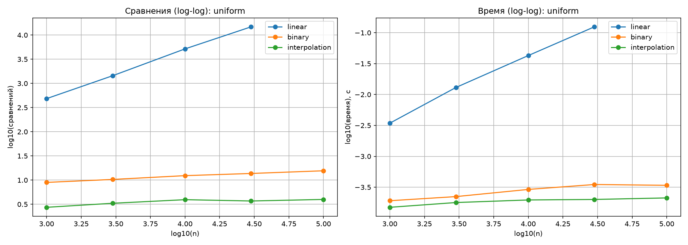
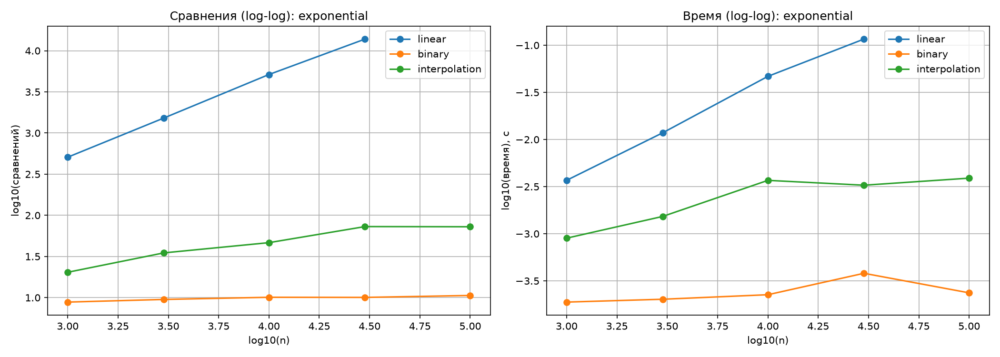

# Лабораторная работа 6. Линейный, бинарный и интерполяционный поиск

## Цель работы
Освоить алгоритмы поиска в линейных структурах: линейный, бинарный и интерполяционный; научиться сравнивать их эффективность на разных распределениях данных.

## Задание
1. Реализовать линейный, бинарный и интерполяционный поиск.
2. Сравнить количество сравнений и время работы на равномерном и экспоненциальном распределениях.
3. Построить графики и объяснить, когда интерполяционный поиск превосходит бинарный, а когда деградирует.

## Реализованные алгоритмы
Код находится в файле [`lab06-search.py`](lab06-search.py).

- `linear_search` - линейный поиск (O(n)).
- `binary_search` - бинарный поиск (O(log n)).
- `interpolation_search` - интерполяционный поиск (O(log log n) на равномерных данных).

## Результаты замеров

### Равномерное распределение (uniform)

| n | Linear | Binary | Interpolation |
| :--- | :--- | :--- | :--- |
| 1 000 | 483.9 | 9.0 | **2.7** |
| 10 000 | 5175.5 | 12.4 | **3.9** |
| 30 000 | 14788.0 | 13.7 | **3.7** |

### Экспоненциальное распределение (exponential)

| n | Binary | Interpolation |
| :--- | :--- | :--- |
| 1 000 | 8.8 | 20.3 |
| 10 000 | 10.1 | 46.5 |
| 30 000 | 10.1 | 73.0 |

## Графики
### Равномерное распределение

### Экспоненциальное распределение

### Анализ графиков:
1. На равномерных данных интерполяционный поиск делает **в 3-4 раза меньше сравнений**, чем бинарный, и работает быстрее. Это доказывает его сложность O(log log n).
2. На экспоненциальных данных интерполяционный поиск **деградирует**: количество сравнений растет (с 20 до 73), так как формула интерполяции плохо предсказывает позицию числа в сгущенном массиве.
3. Бинарный поиск стабилен на любых данных (9-16 сравнений), так как всегда делит массив пополам.

## Вывод
В ходе лабораторной работы были реализованы три алгоритма поиска. Экспериментально подтверждено, что линейный поиск работает за O(n) и делает тысячи сравнений. Бинарный поиск работает за O(log n) и стабилен на любых данных. Интерполяционный поиск на равномерных данных работает быстрее всех (O(log log n)), но на неравномерных данных деградирует из-за плохого предсказания позиции.