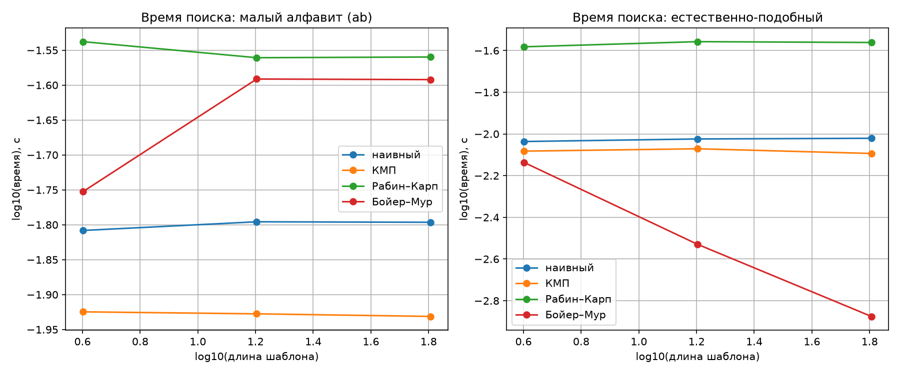

# Лабораторная работа 7. Поиск подстрок: КМП, Рабин-Карп, Бойер-Мур

## Цель работы
Реализовать и сравнить алгоритмы поиска подстрок: наивный, Кнута-Морриса-Пратта (КМП), Рабина-Карпа и Бойера-Мура.

## Задание
1. Реализовать 4 алгоритма поиска подстрок.
2. Сравнить их по числу сравнений и времени работы на двух типах текстов: малый алфавит (ab) и естественно-подобный текст.
3. Объяснить, когда какой алгоритм лучше применять.

## Реализованные алгоритмы
Код находится в файле [`lab07-substring.py`](lab07-substring.py).

- `naive_search` - наивный поиск (O(n * m)).
- `kmp_search` - алгоритм Кнута-Морриса-Пратта (O(n + m)).
- `rabin_karp_search` - алгоритм Рабина-Карпа (O(n + m) в среднем).
- `boyer_moore_search` - алгоритм Бойера-Мура (O(n / m) в среднем).

## Результаты замеров

### Текст: малый алфавит (ab)

| Длина шаблона | Наивный (сравн.) | КМП (сравн.) | Рабин-Карп (сравн.) | Бойер-Мур (сравн.) |
| :--- | :--- | :--- | :--- | :--- |
| 4 | 187 232 | 162 449 | 24 992 | 187 703 |
| 16 | 199 987 | 181 489 | 128 | 200 525 |
| 64 | 200 721 | 190 529 | 384 | 109 090 |

### Текст: естественно-подобный

| Длина шаблона | Наивный (сравн.) | КМП (сравн.) | Рабин-Карп (сравн.) | Бойер-Мур (сравн.) |
| :--- | :--- | :--- | :--- | :--- |
| 4 | 110 335 | 110 338 | 4 088 | 35 342 |
| 16 | 119 224 | 118 165 | 112 | 16 191 |
| 64 | 113 283 | 113 334 | 384 | 10 062 |

## Графики

### Анализ графиков и таблиц:
1. **КМП** делает не «ровно n», а реальное число сравнений символов. На малом алфавите (ab) он экономит 10–20% по сравнению с наивным, потому что префикс-функция позволяет не откатываться далеко назад. На естественном тексте разница с наивным почти незаметна, так как наивный и так быстро отсекает на первом символе.
2. **Наивный** на малом алфавите делает почти `n * m` сравнений (около 200 000). Это худший случай: шаблон часто почти совпадает с текстом (например, `abab` и `abaa`), поэтому проверка не обрывается на первом символе. На естественном тексте он делает чуть больше n (около 110 000), так как символы разнообразны и несовпадение обычно находится сразу.
3. **Бойер-Мур** на естественном тексте с длинным шаблоном (64) делает всего 10 062 сравнения. Это в 11 раз меньше, чем у наивного и КМП! Он выигрывает за счет эвристики плохого символа: когда последний символ не совпал, алгоритм может сдвинуться сразу на много позиций. На малом алфавите (ab) он деградирует, так как сдвиг часто равен 1–2.
4. **Рабин-Карп** делает очень мало посимвольных сравнений (от 112 до 4 088), потому что сравнивает хеши, а посимвольно проверяет только при их совпадении. Но по времени в Python он часто медленнее всех из-за накладных расходов на вычисление хешей (арифметика с большими числами).

## Вывод
1. **Наивный** - прост, но плох на малом алфавите и длинных шаблонах (O(n * m)).
2. **КМП** - универсален и предсказуем, всегда O(n + m), не зависит от алфавита. Хороший выбор, когда нужна стабильность.
3. **Рабин-Карп** - хорош для поиска нескольких шаблонов одновременно или когда важна скорость на «идеальных» данных, но в Python медленный из-за арифметики.
4. **Бойер-Мур** - лучший выбор для больших текстов с большим алфавитом (естественный язык). На малом алфавите деградирует.